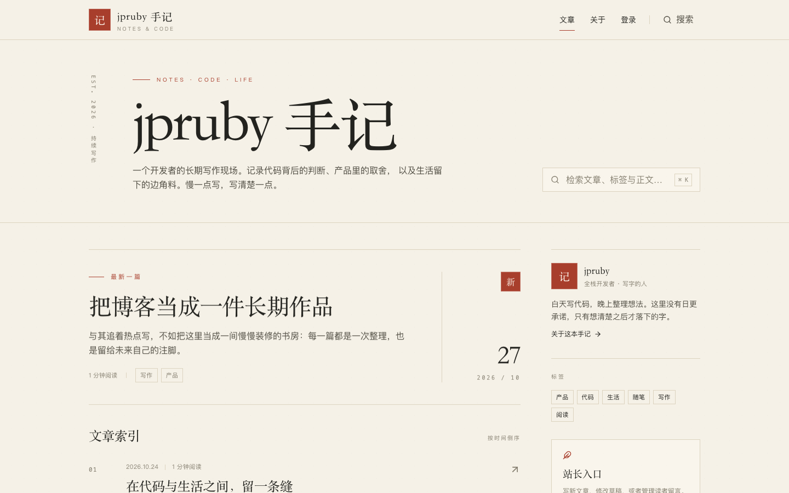
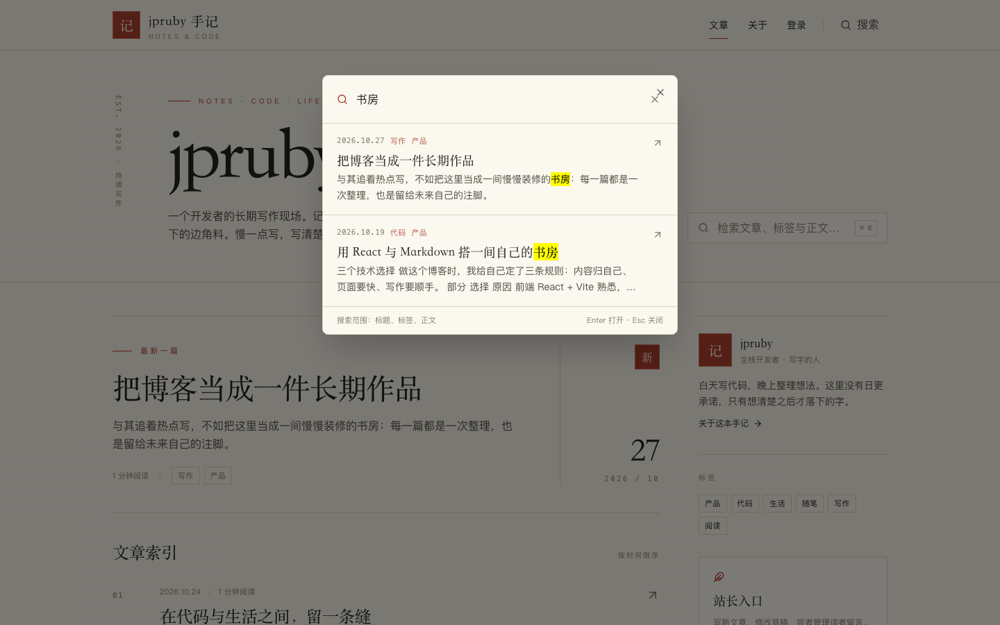
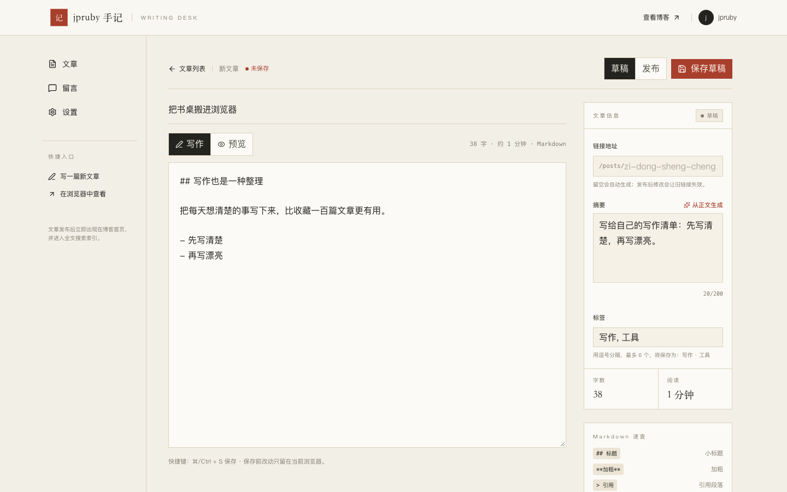
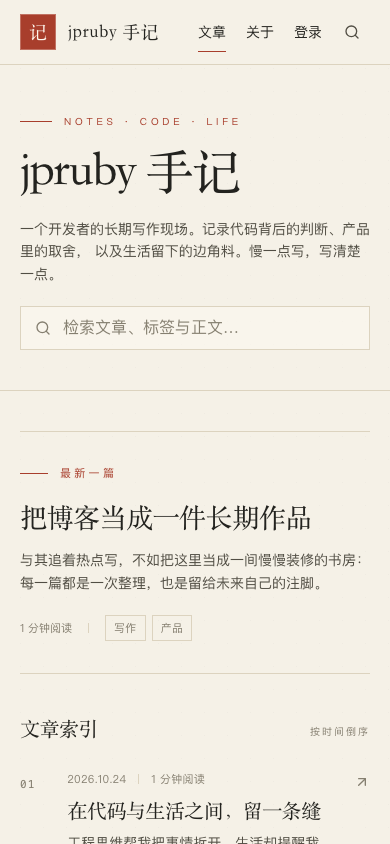

# jpruby 手记

一个可以真正上线用的个人博客：React + Vite 前端，Qoder Sites 托管的 PostgreSQL 数据库与 Deno Edge Function 后端。**评论、全文搜索、网页后台写作**三件套齐全，不依赖第三方博客平台，账号也完全归自己。

首页 · 桌面端



全文搜索（⌘K / Ctrl K 唤起，命中词高亮）



写作台（Markdown 写作 + 实时预览 + 元信息面板）



<p>
  
</p>

---

## 功能

### 阅读端

- **文章索引**：按发布时间倒序，分页加载，首页有「最新一篇」大卡片
- **标签筛选**：按标签过滤已发布文章，标签自动聚合计数
- **文章详情**：Markdown 渲染（标题、列表、引用、代码块高亮、GFM 表格与任务列表）、阅读时长、日期、标签
- **全文搜索**：标题、摘要、标签、正文一起搜，显示命中片段并高亮关键词
- **评论**：访客填昵称和内容即可留言；服务端限流，带蜜罐字段拦截简单机器人
- **响应式**：桌面、平板、手机都有完整布局；每页有独立的文档标题

### 写作台（`/admin`）

- **登录鉴权**：用户名 + 密码，首次登录强制设置自己的新密码；登录接口限流
- **文章管理**：新建、编辑、删除；「草稿 / 发布」两态随时切换
- **Markdown 写作**：左侧写作、右侧预览，支持快捷键（⌘/Ctrl + S 保存）
- **元信息**：链接地址（slug，留空自动生成）、摘要（留空自动从正文提取）、标签（最多 6 个）、字数与阅读时长自动计算
- **乐观锁**：保存时携带版本号，多标签页同时编辑不会互相覆盖（冲突返回 409）
- **评论管理**：查看全部留言，逐条删除
- **账号设置**：改密码、退出登录；改密后旧会话全部失效

## 技术栈

| 层次 | 选型 |
| --- | --- |
| 前端框架 | React 19 + TypeScript + Vite 8 |
| 样式 | Tailwind CSS 4（纸感米白 + 墨黑 + 朱砂的排版风格） |
| 路由 | react-router-dom 7 |
| Markdown | react-markdown + remark-gfm + rehype-highlight |
| 交互 | sonner（提示）、lucide-react（图标）、Radix/Base UI（弹层与表单原语） |
| 后端 | Deno Edge Function（Qoder Sites Function，单文件路由） |
| 数据库 | PostgreSQL（Qoder Sites 托管，`function_backend` 访问模式） |
| 搜索 | 服务端内存匹配（≤500 篇已发布文章），个人博客规模无需额外搜索服务 |

## 目录结构

```
├── src/
│   ├── admin/              写作台外壳、登录门槛、会话上下文
│   ├── components/         公共布局、页头页脚、搜索弹层
│   ├── hooks/              文档标题
│   ├── lib/
│   │   ├── api.ts          前端 API 客户端（含会话令牌存取）
│   │   ├── format.ts       Markdown 摘要 / 纯文本工具
│   │   └── types.ts        共享类型
│   ├── pages/              首页、文章页、关于、404
│   │   └── admin/          文章列表、编辑器、评论管理、设置
│   └── App.tsx             路由表
├── functions/
│   ├── index.ts            Function 入口（部署时由平台注入 backend.mjs）
│   └── routes.mjs          全部业务路由：鉴权、文章、评论、搜索
├── dev/
│   ├── local-api.mjs       本地内存数据库 + 示例数据（零依赖，端口 8000）
│   └── cdp-check.mjs       无头 Chrome 端到端自检（截图落在 dev/shots/）
├── scripts/
│   ├── build.mjs           生产构建
│   ├── check-node.mjs      Node 版本检查
│   └── new-admin.mjs       生成站长初始凭证（PBKDF2 哈希）
├── schema.sql              数据库结构（迁移用）
└── PROVENANCE.md           界面模板来源说明
```

## 本地开发

环境要求：Node.js 22.13+ 或 24+。

```bash
npm install
```

开两个终端：

```bash
# 终端 1：本地博客 API（内存数据库 + 示例文章，重启即重置）
node dev/local-api.mjs
# → http://127.0.0.1:8000

# 终端 2：前端开发服务器（把 /functions/v1/app 代理到 8000）
npm run dev
# → http://127.0.0.1:5173
```

打开 <http://127.0.0.1:5173> 就能看到带示例文章的博客。

**本地演示账号**：`jpruby` / `local-dev-2026`。首次登录会被要求设置新密码（本地也是真实校验，只是数据只存在内存里，重启 `dev/local-api.mjs` 就恢复成示例数据）。

其他命令：

```bash
npm run build            # 类型检查 + 生产构建到 dist/
npm run preview          # 预览生产构建（同样带 API 代理）
npm run check:function   # 用 Deno 检查 Function 类型（需自行安装 Deno）
node dev/cdp-check.mjs   # 无头 Chrome 跑完整 UI 自检（需两个服务都在跑、本机有 Chrome）
```

## 部署到你自己的站点（Qoder Sites）

整个项目就是为 Qoder Sites 准备的：静态前端 + 一个 Function + 一个 PostgreSQL 数据库。用 Qoder 桌面端的 Sites 插件（sites-building / sites-hosting 技能）按下面顺序走：

1. **创建站点并开通后端**：新建 Project 与 Site，开通「数据库 + Functions」，数据库访问模式选择 `function_backend`（数据库只允许通过 Function 访问，不对浏览器暴露）。
2. **建表**：把 `schema.sql` 通过 Sites 的数据库迁移工具应用。迁移只支持受限 DDL（`CREATE TABLE`、`ALTER TABLE ADD COLUMN`、`CREATE INDEX`），不支持 `DROP`、`CHECK` 和种子数据——`schema.sql` 已按这个子集写好。
3. **生成站长账号**：

   ```bash
   node scripts/new-admin.mjs <你的用户名>
   # 不传密码会生成一个随机强密码，输出里只显示一次
   ```

   把输出的 `password_hash`、`password_salt`、`iterations` 连同 `id = owner`、`username`、`must_change = true` 写入 `app.admin_account` 表（可以通过 Sites 的数据管理工具插入一行）。时间字段 `created_at` / `updated_at` 也必须显式给值。
4. **构建并发布**：`npm run build` 产出 `dist/`，发布参数为 `webDirectory: dist`、`functionDirectory: functions`、`databaseAccess: read_write`、`spa: true`，并带上最新的 `schemaRef`。
5. **首次登录**：打开你的站点 `/admin`，用第 3 步生成的账号登录，按提示设置自己的密码。

### 部署时容易踩的坑

- `functions/_qoder/backend.mjs` 由平台在部署时注入，**仓库里没有这个文件，也不要手写**。本地开发用 `dev/local-api.mjs` 模拟了同样的注入。
- **会话令牌走自定义请求头 `x-blog-token`**。Qoder Sites 的部署网关会剥离 `Authorization` 和 `Cookie`，自定义头会原样转发；换到别的平台部署时，把 `functions/routes.mjs` 里的 `sessionToken()` 改成读你的宿主支持的请求头即可。
- 数据库凭据不落在仓库里：Function 通过平台注入的数据库客户端访问，前端产物中没有任何连接串或密钥。
- `schema.sql` 里的 `admin_account` 首次需要手动写入一行；没有这行时 `/admin` 会提示账号未初始化，公开页面不受影响。

## 后台使用说明

- **入口**：导航栏「关于」后面的「登录」，或直接访问 `/admin`。
- **第一次登录**：必须先设置新密码（至少 8 位，不能与初始密码相同），设置完直接进入写作台。
- **写文章**：点「新建文章」，填标题和正文（Markdown）。「发布」后读者立即可见；「草稿」只有登录后才能看到。
- **改文章**：文章列表点进去编辑；保存会带上版本号，如果同一篇在别处被改过，会提示冲突而不是悄悄覆盖。
- **删文章**：会连同这篇文章的评论一起删除（先确认）。
- **评论管理**：留言页可以看到所有文章的全部留言并逐条删除。
- **改密码 / 退出**：左上角「设置」页。
- **忘记密码**：本地用 `node scripts/new-admin.mjs` 重新生成一组凭证，更新 `admin_account` 里 `owner` 那一行的 `password_hash`、`password_salt`、`iterations`，并把 `must_change` 置回 `true`；用户名不要改。

## 改成你自己的站点

这个仓库现在带着我的站名和署名，部署前把这些换成你自己的（可以整体搜一遍）：

```bash
grep -rn "jpruby" src index.html functions
```

| 位置 | 改什么 |
| --- | --- |
| `index.html` | 页面标题、描述、Open Graph 标签 |
| `src/hooks/use-document-title.ts` | `SITE_TITLE` 与页面标题后缀 |
| `src/components/site-header.tsx` / `site-footer.tsx` | 站名、页脚署名与版权 |
| `src/pages/home-page.tsx` | 首页大标题、侧栏作者介绍 |
| `src/pages/about-page.tsx` | 关于页介绍文字 |
| `src/pages/post-page.tsx` | 文末作者署名 |
| `src/admin/admin-layout.tsx` | 写作台左上角名称 |
| `src/lib/api.ts` | `TOKEN_KEY`（建议加自己的前缀，避免同一域名下多个站点互相读到令牌） |
| `functions/routes.mjs` | `/api/health` 返回的 service 名称 |
| `public/favicon.svg` | 站点图标 |

配色、字体、间距集中在 `src/globals.css` 的 Tailwind 主题变量里（`--color-paper`、`--color-ink`、`--color-cinnabar` 等），想换整体气质改那里最快。示例文章在 `dev/local-api.mjs`，只用于本地预览，不会带到线上数据库。

## 数据模型

| 表 | 说明 |
| --- | --- |
| `posts` | 文章：`id`、`slug`（唯一）、`title`、`excerpt`、`content`、`search_text`、`tags`（jsonb）、`status`（`draft` / `published`）、`version`（乐观锁）、`reading_minutes`、`published_at`、`created_at`、`updated_at` |
| `comments` | 评论：`id`、`post_id`（外键）、`nickname`、`content`、`created_at` |
| `admin_account` | 站长账号：`id`（固定 `owner`）、`username`（唯一）、`password_hash`、`password_salt`、`iterations`、`must_change`、时间戳 |
| `admin_session` | 登录会话：`id`、`token_hash`（唯一）、`account_id`、`created_at`、`expires_at` |

## API 一览

公开接口：

| 方法 | 路径 | 说明 |
| --- | --- | --- |
| GET | `/api/health` | 健康检查 |
| GET | `/api/posts?offset&limit&tag` | 已发布文章列表（默认 12 条，最多 24） |
| GET | `/api/tags` | 标签与文章数 |
| GET | `/api/search?q=` | 全文搜索（关键词 ≤60 字，最多返回 20 条） |
| GET | `/api/posts/:slug` | 文章详情 |
| GET | `/api/posts/:slug/comments` | 评论列表 |
| POST | `/api/posts/:slug/comments` | 发表评论（昵称 ≤24 字、内容 ≤800 字，限流 8 次/分钟/IP） |

写作台接口（除登录外都要求请求头 `x-blog-token: <会话令牌>`）：

| 方法 | 路径 | 说明 |
| --- | --- | --- |
| GET | `/api/admin/session` | 当前登录状态（未登录也返回 200，`authenticated: false`） |
| POST | `/api/admin/login` | 登录（限流 12 次/5 分钟/IP），返回令牌 |
| POST | `/api/admin/logout` | 退出，当前会话立即失效 |
| POST | `/api/admin/password` | 修改密码（校验原密码；成功后旧会话全部失效并换发新令牌） |
| GET | `/api/admin/posts` | 全部文章（含草稿） |
| POST | `/api/admin/posts` | 新建文章（可直接发布，也可存草稿） |
| GET | `/api/admin/posts/:id` | 文章详情（编辑用，含 `version`） |
| PATCH | `/api/admin/posts/:id` | 更新文章（必须带 `version`，不一致返回 409） |
| DELETE | `/api/admin/posts/:id` | 删除文章（连带评论） |
| GET | `/api/admin/comments` | 全部评论 |
| DELETE | `/api/admin/comments/:id` | 删除单条评论 |

文章字段限制：标题 ≤120 字、正文 ≤120,000 字符、摘要 ≤200 字、slug 为小写字母数字连字符（≤80）、标签 ≤6 个（每个 ≤20 字）。

## 安全设计

- **密码存储**：PBKDF2-SHA256，210,000 次迭代，16 字节随机盐，派生 256 位哈希后 base64url 编码；比较使用常量时间实现。
- **会话**：登录生成 32 字节随机令牌，数据库只存其 SHA-256 哈希；有效期 30 天；退出登录、修改密码都会让旧会话立即失效。
- **限流**：登录 12 次 / 5 分钟 / IP，评论 8 次 / 分钟 / IP（进程内计数，适合单实例部署；多实例时请换成共享存储）。
- **强制改密**：首次登录必须先设置自己的密码，密码至少 8 位且不能与初始密码相同。
- **令牌存放**：浏览器 `localStorage`（`x-blog-token` 请求头传输）。文章与评论都按文本 / Markdown 安全渲染，不注入用户可控的原始 HTML；如果你后续允许原始 HTML 或引入富文本，建议把令牌改成 HttpOnly Cookie 并配 CSP。
- **数据库凭据**：由平台注入，仓库、前端产物、浏览器里都没有连接串或密钥。

## 常见问题

**本地登录提示「用户名或密码不正确」？**
本地数据存在内存里，重启 `dev/local-api.mjs` 会重置为示例账号 `jpruby` / `local-dev-2026`。如果你在界面里改过密码，重启服务即可恢复。

**写作台显示「暂时打不开」？**
检查本地函数是否在 8000 端口运行（`node dev/local-api.mjs`），以及 `npm run dev` 是否把 `/functions/v1/app` 代理过去。

**部署后登录一直 401 / 页面显示未登录？**
按顺序确认：`admin_account` 里已插入 `owner` 行；部署的是包含最新 `functions/` 的版本；请求确实带了 `x-blog-token` 头（不是 `Authorization`）。

**数据库迁移被拒绝？**
Sites 迁移只支持受限 DDL：`CREATE TABLE`、`ALTER TABLE ADD COLUMN`（可空、无默认值）、普通 `CREATE INDEX`；不支持 `DROP`、`CHECK`、函数/触发器、种子数据。按报错里的 `validation_reason` 调整 SQL。

**搜索能支撑多少篇文章？**
目前对最多 500 篇已发布文章做服务端匹配，个人写作量级完全够用。如果以后文章上千，把 `/api/search` 换成 PostgreSQL 全文索引（`tsvector`）或接外部搜索即可。

## 来源与许可

界面基于 Qoder Sites 的 React starter 模板（详见 [PROVENANCE.md](PROVENANCE.md)），博客的业务逻辑、API、写作台与登录系统都在此之上实现。

[MIT License](LICENSE) —— 随意使用、修改、再发布。如果这个项目帮到了你，点个 Star 就好。
